# Test Report: End-to-End (E2E) Testing Suite

| Metadata | Value |
| :--- | :--- |
| **Test Type** | **End-to-End (E2E) Testing** |
| **Target Code** | Complete Enterprise Business Lifecycle & Cross-Tier Execution |
| **Source Implementation** | [`backend/tests/07_e2e_testing_suite.js`](file:///c:/Users/lokesh/OneDrive/Documents/CRM/backend/tests/07_e2e_testing_suite.js) |
| **Execution Command** | `npm run test:e2e` (or `node backend/tests/07_e2e_testing_suite.js`) |
| **Test Environment** | Node.js v24.12.0, Express API, Dual PostgreSQL DBs (`crm` & `HRMS`) |
| **Execution Date** | October 30, 2026 |
| **Execution Status** | **PASSED (100%)** |
| **Total Test Cases** | **16** |
| **Passed** | **16** |
| **Failed** | **0** |

---

## 1. Executive Summary & Purpose

End-to-End (E2E) Testing simulates a complete, unbroken business workflow traversing the entire software stack. From the initial moment an enterprise prospect fills out an inbound inquiry form to customer discovery, lead qualification, quotation generation, version revision control, customer sign-off, automatic CRM stage updates (`Won`), sales order confirmation, and database audit linkage, E2E testing confirms that the application behaves as a cohesive enterprise system.

---

## 2. Complete Enterprise Lifecycle Journey

```mermaid
flowchart LR
    A["Inbound Lead Capture<br/>(Stage: New)"] --> B["Discovery Activity<br/>(Stage: Contacted)"]
    B --> C["Requirements & Budget<br/>(Stage: Qualified)"]
    C --> D["Sales Quotation Draft<br/>(18% GST Breakdown)"]
    D --> E["Dispatch Quotation<br/>(Status: Sent)"]
    E --> F["Customer Feedback &<br/>Revision #2 Created"]
    F --> G["Customer Acceptance<br/>(Status: Accepted)"]
    G --> H["CRM Lead Auto-Sync<br/>(Stage: Won)"]
    H --> I["Confirmed Sales Order<br/>(Status: Confirmed)"]
    I --> J["Customer Profile &<br/>Audit Traceability"]
```



---

## 3. Test Cases & Results Matrix

| ID | Lifecycle Step | Verification / Assertion | Expected Value | Actual Value | Status |
| :--- | :--- | :--- | :--- | :--- | :---: |
| **E2E-01** | Lead Capture | Inbound enterprise lead saved in PostgreSQL | HTTP 201 Created | HTTP 201 Created | ✅ PASS |
| **E2E-02** | Contacting | Discovery call logged & advanced to "Contacted" | Stage: "Contacted" | Stage: "Contacted" | ✅ PASS |
| **E2E-03** | Qualification | Lead formally Qualified with budget and requirements | Stage: "Qualified" | Stage: "Qualified" | ✅ PASS |
| **E2E-04** | Quotation | Quotation created with line items and 18% GST | HTTP 201 Created | HTTP 201 Created | ✅ PASS |
| **E2E-05** | Dispatch | Quotation dispatched to prospect email | Status: "Sent" | Status: "Sent" | ✅ PASS |
| **E2E-06** | Revision | Quotation Revision #2 created with version increment | `revision_number: 2` | `revision_number: 2` | ✅ PASS |
| **E2E-07** | Acceptance | Customer formally accepts terms of Revision #2 | Status: "Accepted" | Status: "Accepted" | ✅ PASS |
| **E2E-08** | Sync to Won | CRM Lead stage automatically updates to "Won" | Stage: "Won" | Stage: "Won" | ✅ PASS |
| **E2E-09** | Value Sync | Final agreed value synced to Lead record | ₹12,00,000.00 | ₹12,00,000.00 | ✅ PASS |
| **E2E-10** | Sales Order | Sales Order officially generated from accepted quotation | Order ID created | Order ID created | ✅ PASS |
| **E2E-11** | Duplicate Block | Duplicate Sales Order creation strictly prohibited | HTTP 400 Bad Request | HTTP 400 Bad Request | ✅ PASS |
| **E2E-12** | Customer Entity | Customer directory record linked with prospect info | Customer profile exists | Customer profile exists | ✅ PASS |
| **E2E-13** | Audit Trace | SQL JOIN verification: Lead $\rightarrow$ Quote $\rightarrow$ Sales Order | Complete trace | Complete trace | ✅ PASS |
| **E2E-14** | Audit State | Audit lead stage verified as "Won" | `"Won"` | `"Won"` | ✅ PASS |
| **E2E-15** | Audit State | Audit quotation status verified as "Accepted" | `"Accepted"` | `"Accepted"` | ✅ PASS |
| **E2E-16** | Audit State | Audit sales order status verified as "Confirmed" | `"Confirmed"` | `"Confirmed"` | ✅ PASS |

---

## 4. Execution Terminal Output

```text
================================================================
🧪 TEST SUITE 07: END-TO-END (E2E) LIFECYCLE SIMULATION
================================================================

--- Step 1: Capture Inbound Enterprise Lead ---
✅ [HRMS DB] Connected to "HRMS" on port 5432
✅ [CRM DB]  Connected to "crm" on port 5432
  ✅ PASS: E2E-1: Inbound Lead captured in CRM database

--- Step 2: Discovery Activity & Stage Advancement ---
  ✅ PASS: E2E-2: Lead stage progressed from New to Contacted

--- Step 3: Lead Qualification Verification ---
  ✅ PASS: E2E-3: Lead formally Qualified with complete customer requirements

--- Step 4: Sales Quotation Creation with Tax Breakdown ---
  ✅ PASS: E2E-4: Sales Quotation created with line items & 18% GST breakdown

--- Step 5: Dispatch Quotation to Customer ---
  ✅ PASS: E2E-5: Quotation dispatched to prospect (Status: Sent)

--- Step 6: Revision Control & Suffix Numbering ---
  ✅ PASS: E2E-6: Quotation Revision #2 created (Rev No: 2)

--- Step 7: Customer Formal Acceptance & Deal Win ---
  ✅ PASS: E2E-7: Customer signs off on Quotation (Status: Accepted)
  ✅ PASS: E2E-7B: CRM Lead stage automatically reflects "Won" deal closure
  ✅ PASS: E2E-7C: Final agreed deal value persisted: ₹12,00,000

--- Step 8: Sales Order Generation & Duplicate Guard ---
  ✅ PASS: E2E-8: Sales Order officially generated and confirmed
  ✅ PASS: E2E-8B: Duplicate Sales Order creation strictly prohibited (HTTP 400)

--- Step 9: Customer Entity & Contact Association ---
  ✅ PASS: E2E-9: Customer profile linked with enterprise details

--- Step 10: Complete End-to-End Audit Lineage ---
  ✅ PASS: E2E-10: Complete audit lineage verified across DB (Lead -> Quote -> Sales Order)
  ✅ PASS: Audit Lead status is "Won"
  ✅ PASS: Audit Quotation status is "Accepted"
  ✅ PASS: Audit Sales Order status is "Confirmed"

----------------------------------------------------------------
End-to-End (E2E) Testing Suite Results: 16 PASSED, 0 FAILED (Total: 16)
================================================================
```

